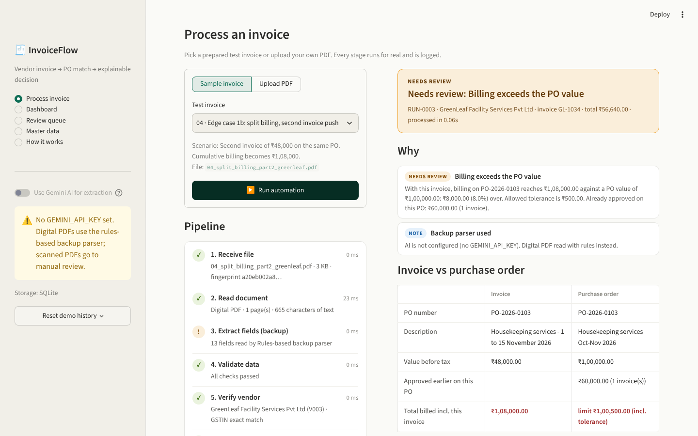
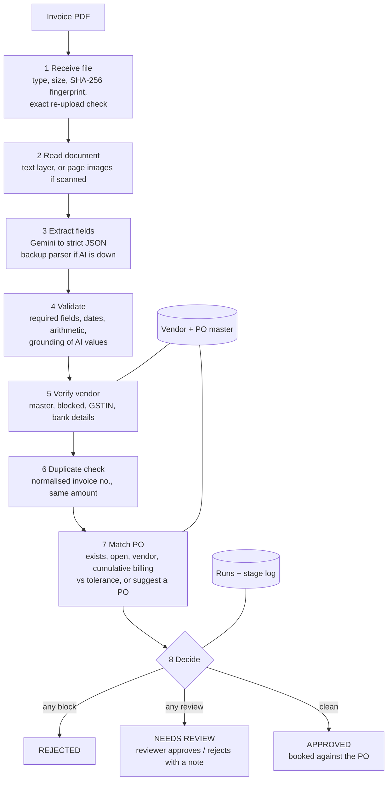

# InvoiceFlow: AP invoice automation (PS-1)

A working process that takes a vendor invoice PDF and produces a **clear, reasoned decision**
(Approve / Needs review / Reject), with every stage visible live and every run stored as an audit trail.



**Design rule: the AI reads, the rules decide.** Gemini turns a messy PDF (any layout, digital or scanned)
into structured fields. Every payment decision comes from fixed, explainable rules, and every value the AI returns
is cross-checked (arithmetic + "does this value really appear in the PDF?") before a rule trusts it.

---

## 1. Quick start (about 5 minutes)

You need **Python 3.11 or newer** (`python --version`).

```bash
# 1. unzip, then open a terminal in the project folder
cd invoice-ap

# 2. create a virtual environment
python -m venv .venv
# Windows:
.venv\Scripts\activate
# Mac / Linux:
source .venv/bin/activate

# 3. install
pip install -r requirements.txt

# 4. add your Gemini key (free from Google AI Studio -> "Get API key")
copy .env.example .env        # Windows
cp .env.example .env          # Mac / Linux
#    then open .env and paste the key after GEMINI_API_KEY=

# 5. run
streamlit run app.py
```

The app opens at http://localhost:8501. The database (`data/ap_automation.db`) and the vendor/PO master data are created automatically on first start.

**No key yet?** The app still runs: digital PDFs go through the rules-based backup parser, and scanned PDFs are routed to manual review. The sidebar tells you which mode is active.

## 2. Verify everything before the demo

```bash
pytest -q                          # 32 automated tests (no internet needed)
python scripts/run_samples.py      # runs all 11 sample invoices through the REAL pipeline (with Gemini if the key is set)
```

`run_samples.py` prints PASS/FAIL for each sample against its expected decision, and uses a separate database, so your demo history is untouched.
**Run it once with your key before the interview.** It is the only check of the live Gemini path (see *Testing*). If any line says FAIL, rerun with `--verbose` to see every stage and finding.

## 3. Deploy (live link for the submission)

Streamlit Community Cloud is free, but its local disk is wiped on restart. History therefore goes to a free Postgres database (Neon).

1. **Database:** create a free project at neon.com and copy the connection string (`postgresql://...`).
2. **GitHub:** push this folder to a GitHub repository. `.env` and `*.db` are git-ignored, so your key is not uploaded.
3. **Streamlit:** go to share.streamlit.io, click *Create app*, pick the repo, set the main file to `app.py`, and under *Advanced settings* choose Python 3.12.
4. **Secrets:** in the app's *Settings → Secrets*, paste the following (see `.streamlit/secrets.toml.example`):
   ```toml
   GEMINI_API_KEY = "your-key"
   DATABASE_URL = "postgresql://...your neon string..."
   ```
5. **Warm-up:** open the app and process one invoice. Neon sleeps when idle, so the first query after a pause takes a few seconds. Do this a few minutes before the interview.

The app converts `postgresql://` URLs to the installed driver automatically, so no code changes are needed.

---

## 4. How the process works



| Stage | Uses AI? | Why this way |
|---|---|---|
| 1 Receive file | No | Fingerprinting stops exact re-uploads before any AI cost. |
| 2 Read document | No | Local text extraction is free and lets us *verify* the AI later. |
| 3 Extract fields | **Yes** | Layouts vary endlessly; this is where an LLM genuinely beats templates. The output is forced into a Pydantic schema, with "null, never guess" for missing values. |
| 4 Validate | No | Maths and grounding catch both vendor mistakes and AI misreads. |
| 5–7 Checks | No | Money decisions must be consistent, auditable and explainable. |
| 8 Decide | No | `block` → Reject · `review` → Needs review · otherwise Approve. |

AI is also used, on demand, to **draft the email back to the vendor**. The facts come from the findings, and a human sends it.

### Business rules (assumptions, all in `ap_automation/config.py`)

| Rule | Value |
|---|---|
| Amount tolerance over PO | 1% of PO value or ₹500, whichever is **smaller** |
| What is compared to the PO | Pre-tax amount (taxable value); tax is checked separately against the PO's GST rate |
| PO consumption | Sum of invoices approved (automatically or by a reviewer) on that PO |
| Auto-approval limit | Totals above ₹5,00,000 always need a person |
| Duplicate | Same vendor + same invoice number after normalising (`TS-INV-0451` = `TS/INV/451`) → Reject. Same vendor + same total within 45 days → Needs review |
| Exact re-upload | Same SHA-256 as an approved/pending run → Reject at intake |
| Vendor match | GSTIN exact match first; otherwise fuzzy name ≥ 90% automatic, 75–90% needs review |
| Bank details | Account on the invoice ≠ vendor master → Needs review (classic invoice fraud) |
| Missing PO | Rank the vendor's open POs by amount (60 pts) + description (40 pts); suggest the best (≥ 70), **never auto-approve** |
| Dates | Missing → review · future → review · before the PO date → review · older than a year → review |

## 5. Edge cases

Run them in this order (they depend on history). Sample files are in `sample_invoices/` and can be regenerated with `python scripts/generate_sample_invoices.py`.

| # | Input | Problem | How the system detects it | Decision and output | Why this is right |
|---|---|---|---|---|---|
| 1 | `03` then `04`: two GreenLeaf invoices (₹60,000 then ₹48,000) on a ₹1,00,000 PO | Each invoice alone is fine; together they over-bill by ₹8,000 | PO stage sums invoices already approved on the PO (stateful, across runs) | `03` **Approved** (₹40,000 left). `04` **Needs review**: "billing reaches ₹1,08,000 against ₹1,00,000, ₹8,000 (8.0%) over; tolerance ₹500" | Split billing is common and legitimate, but overruns need a budget owner. Run `04` alone and it is approved, which proves the rule uses history. |
| 2 | `05`: the TechSupply invoice re-sent as `TS/INV/451` in a new PDF (after `01` was approved) | Different file and different number format, so a naive check sees a new invoice | Invoice numbers normalised (`TSINV451` both); same vendor → match with RUN-0001 | **Rejected**: duplicate of RUN-0001; PO stage skipped | Paying twice is the most expensive AP error. An identical file is caught even earlier, at intake, before spending an AI call. |
| 3 | `06`: Swift Logistics invoice with **no PO number**; the vendor has 2 open POs | The guide's "implied PO" | Candidates scored on amount and description: PO-2026-0104 scores 96/100, PO-2026-0105 scores 47 | **Needs review** with the suggested PO preselected in the reviewer's dropdown | Inferred matches help the clerk but must never move money on their own. |
| 4 | `07`: **scanned** image PDF (no text layer); the invoice date is simply not printed (only "30 days from invoice date") | Scanned and missing critical info; the temptation is to guess the date | No text layer → page image to the Gemini vision model; prompt says "null, never compute from terms"; validation flags `MISSING_INVOICE_DATE` | **Needs review** + "Draft email to vendor" asking for the date. Without AI it goes to manual entry, never a guess | The guide says the process must not silently approve when critical information is missing. |
| Bonus | `08`: TechSupply invoice, everything matches, but **new bank account** "please update your records" | Business-email-compromise style fraud | Account on invoice ≠ vendor master | **Needs review** with instructions to verify by phone using a number already on file | This is the costliest real-world AP fraud pattern. |

Also covered: blocked vendor (`09` → Rejected), not an invoice (`10` → Rejected), corrupted file (`11` → Rejected, not a crash), within-tolerance overage (`02` → Approved with note), AI rate limit (falls back to the next model, then to the backup parser), and any unexpected error (run marked ERROR, never approved).

## 6. Testing

### What was actually run

| Test | Expected | Actual | How verified |
|---|---|---|---|
| 01 happy path | Approved, PO booked ₹3,10,000 | Approved, `approved_billing = (310000, 1)` | `test_happy_path_is_approved_and_books_po` + `run_samples.py` |
| 02 within tolerance (+₹80) | Approved with note | Approved, `WITHIN_TOLERANCE` | test + script |
| 03 → 04 split billing | Approved → Needs review (8% over) | Same; message contains ₹1,08,000 and ₹8,000 | test + script + browser |
| 04 alone | Approved | Approved | `test_split_billing_part2_alone_is_fine` |
| 05 disguised duplicate | Rejected, PO stage skipped | Same | test + script |
| Same file twice | Rejected at intake, extraction skipped | Same | `test_exact_same_file_is_stopped_at_intake` |
| 06 no PO | Needs review, suggests PO-2026-0104 | Same, score 96/100 | test + script + browser |
| 07 scanned, no AI | Needs review (manual entry) | Same | test + script |
| 07 scanned, AI returns null date | Needs review, `MISSING_INVOICE_DATE`, image sent | Same | fake-client test |
| 08 bank change | Needs review | Same | test + script |
| 09 blocked vendor | Rejected | Same | test + script |
| 10 not an invoice | Rejected | Same | test + script |
| 11 corrupted PDF, empty file, `.txt` | Rejected, no crash | Same | tests |
| Crash inside a stage | ERROR, never approved, traceback stored | Same | `test_unexpected_crash_never_approves` |
| AI invents a PO number | Needs review (`NOT_GROUNDED`) | Same | fake-client test |
| AI reads 03/11 as 11 March | Needs review (`INVOICE_BEFORE_PO`) | Same | fake-client test |
| Gemini 429 on first model | Next model used | Same | fake-client test |
| Gemini returns non-JSON twice | Backup parser used | Same | fake-client test |
| Bad API key | Clear error, backup parser | `AIUnavailable` raised | fake-client test |
| UI: every page renders; run 03 + 04; reviewer approval needs a note | No exceptions, metrics update | Same | `tests/test_app.py` (Streamlit AppTest) + headless-browser screenshots |
| Execution history saved | Each run + 8 stage rows in DB | Same | tests read back from DB |

**Honest gap:** the build environment had no internet access to Google, so **real Gemini calls were not run here**.
The Gemini code path is covered with a fake client (request shape, schema, retries, fallbacks, validation), and the full pipeline was run on every sample with the backup parser.
Before the demo, run `python scripts/run_samples.py` with your key to confirm live extraction. All 11 should say PASS.

## 7. Security and privacy

- API keys live only in `.env` / Streamlit Secrets, never in code or git.
- Free-tier Gemini content may be used by Google to improve its products, so only synthetic invoices are used. Production would use the paid tier / Vertex AI with data-processing terms.
- Bank accounts are masked (`****7891`) in the UI. Every manual decision requires a reason and is timestamped.
- Uploaded files are size-limited (10 MB), checked for a real PDF header and opened with a safe parser. They are never executed.
- For production: user login and roles (clerk vs approver), encryption at rest, and retention rules for stored PDFs.

## 8. Limitations and what I'd build next

- Grounding checks are impossible on scanned images (no text). Next step: run OCR so scanned invoices get the same "value must appear" check.
- Matching is at PO-header level. Next step: line-level 3-way match (PO ↔ goods receipt ↔ invoice), with quantity received.
- Email intake (watch an AP mailbox), ERP/PO system integration instead of CSVs, and a per-vendor learning loop from reviewer corrections.
- The duplicate check is per vendor. Cross-vendor duplicates (the same invoice sent via a distributor) are not covered.
- Sample dates are Oct–Nov 2026. More than a year later, the stale-invoice rule will flag them (regenerate the samples with new dates).

## 9. Project map

```
app.py                     Streamlit UI: process (live view), dashboard, review queue, master data, how-it-works
ui_components.py           timeline, decision card, reasons, comparison table (HTML/CSS)
ap_automation/
  pipeline.py              the 8-stage process, timing, persistence, error handling
  extractor_ai.py          Gemini extraction (schema, retries, model fallback)
  extractor_backup.py      rules-based parser used when the AI is unavailable
  rules.py                 validation, vendor, duplicate and PO checks (no AI)
  decision.py              findings -> decision + headline
  db.py                    SQLAlchemy models: vendors, purchase_orders, runs, run_stages
  vendor_email.py          AI-drafted (or template) email back to the vendor
  config.py / utils.py / models.py / pdf_reader.py
data/                      vendors.csv, purchase_orders.csv (the "procurement system")
sample_invoices/           11 test PDFs + catalog.json (scenario + expected decision)
scripts/                   generate_sample_invoices.py, run_samples.py
tests/                     32 pytest tests incl. UI tests
docs/                      DEMO_SCRIPT.md, INTERVIEW_PREP.md, screenshots
```

## Troubleshooting

- A `SyntaxWarning ... invalid escape sequence` from `google/genai/types.py` on first start is harmless (it comes from the Google library on Python 3.13).
- "All Gemini models failed: ... 404" means a model name was retired. Set `GEMINI_MODELS` in `.env` to a current Flash model listed on ai.google.dev/gemini-api/docs/models.
- "... 429" means the free-tier rate limit was hit. Wait a minute; the app falls back automatically in the meantime.
- To start the demo fresh, use **Reset demo history** in the sidebar.
